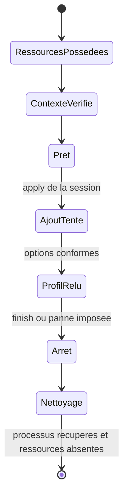

# Exécuteur CAKE Go de laboratoire — contrat v1

Date : 31 octobre 2026.

## État et première portée

**Catalogue, validateurs, contexte, transport et backend natif Go implémentés ; entrée interne et journal durable livrés ; raccordement au superviseur et validations natives Go à réaliser.** Le [pilote privé](LAB_CAKE_TRANSPORT.md) est testé avec de vrais processus et des outils simulés. La passerelle conserve les commandes `inspect` et [`plan`](GATEWAY_PLANNING.md). Ce document fixe la première intégration privilégiée à développer, ses frontières et les preuves requises avant un lancement natif. Le [processus interne](LAB_CAKE_ENTRY.md) est compilable, mais aucune procédure native sous supervision n’est encore prête à exécuter.

La première version est un **contrôle de cycle de vie sur lien DOWN**, équivalent au périmètre du [contrôle CAKE Python déjà validé](LAB_CAKE.md) : ajout du profil, relecture, arrêt et nettoyage normal ou après mort forcée du processus Go. Elle réutilise le superviseur indépendant ; elle ne raccorde pas une interface physique et ne génère aucun trafic de mesure.

Ce contrôle vérifie une primitive d'adaptation système. Il n'exécute pas un résultat `propose_reference` et ne prétend pas valider le chemin actif : aucun `path_validated: true` n'est fabriqué pour satisfaire le planificateur. Le raccordement ultérieur de la planification aux faits d'un chemin actif exigera un protocole séparé. Les validations du réseau du foyer et l'étape 5 restent ouvertes.

## Responsabilités et autorité locale

| Composant | Responsabilité à implémenter |
| --- | --- |
| Lanceur de développement | Préparer un dossier neuf, figer sources/binaire/profil, vérifier leurs empreintes et demander une invocation locale explicite du contrôle. |
| Superviseur Python existant | Posséder les trois espaces neufs et le veth, journaliser les identités, démarrer/surveiller le processus Go dans un groupe distinct, puis arrêter/récupérer les processus et retirer les ressources possédées. |
| Application passerelle Go | Décoder uniquement le contexte interne du contrôle, vérifier sa liaison à la session et à l'espace courant, puis orchestrer le contrôle borné. Aucun exécuteur générique de commandes n'est exposé. |
| Adaptation `platforms/linux` | Résoudre le profil immuable, construire les arguments de `tc`, valider producteur/options/statistiques et retourner les lectures. |
| `packages/core` | Conserver les modèles et la planification pure ; aucun descripteur, processus, appel `tc` ou accès privilégié n'y entre. |

L'accord local du contrôle provient de son invocation explicite, bornée à cette session, à la finalité `cake_down_control` et au profil identifié ci-dessous. Le superviseur l'enregistre avant de permettre l'ajout. Ce mécanisme est propre au laboratoire local de développement ; il ne crée ni consentement persistant du foyer ni autorisation de groupe.

Un fichier de scénario, un JSON `static_cake_plan`, six booléens vrais, des privilèges observés ou la seule présence de CAKE ne confèrent aucune autorité d'exécution. L'interface interne n'accepte pas ces documents comme requêtes. Le superviseur et le binaire figés constituent la base de confiance ; cette frontière ne prétend pas résister à un opérateur root malveillant remplaçant ces programmes.

## Liaison à une session et ressources admises

Le superviseur crée ses espaces `cg-JETON-c/g/s` et sa réservation privée avant de préparer le contrôle. La passerelle et le serveur reçoivent uniquement le veth `wan`/`eth0`, laissé DOWN, sans adresse, route ni activation du forwarding. Le client reste isolé. Une collision ou une création ambiguë ne produit pas d'autorisation d'ajout.

Le processus Go est lancé dans l'espace passerelle possédé. Il reçoit un descripteur ouvert sur cet espace et des canaux anonymes de contrôle/résultat hérités du superviseur, sans accepter de chemin d'espace existant provenant d'un scénario. Le superviseur lie le contexte aux identités périphérique/inode de son journal, vérifie qu'il s'agit de l'espace qu'il vient de créer et qu'il diffère de son propre espace réseau initial.

Avant tout appel de configuration, le processus Go doit confirmer que son espace réseau courant correspond au descripteur reçu et à l'identité attendue. Il vérifie aussi les interfaces attendues, leur état DOWN et l'état initial vide ou unique `noqueue`. Le nom `wan`, un préfixe `cg-` ou des nombres d'inode fournis seuls ne suffisent pas.

La transmission et la conservation de ces descripteurs à travers le lancement dans l'espace réseau doivent être démontrées par un test dédié. Une transmission absente, fermée ou incohérente entraîne un refus, sans repli vers un simple fichier déclaratif. Les descripteurs empruntés sont fermés après usage ; aucun canal de contrôle ne doit être transmis aux processus `tc`. Le superviseur ferme aussi ses propres références avant de confirmer le nettoyage.

## Contexte interne et protocole à sens limité

Le contexte d’initialisation est un objet JSON strict, limité à 4 Kio, transmis sur le canal hérité. Le [codec interne et son contrôle de session](LAB_CAKE_CONTEXT.md) sont maintenant implémentés hors lancement de processus. Tous ses champs sont requis ; champs inconnus, doublons, valeurs nulles et types incorrects sont refusés. Les messages utilisent un préfixe de longueur uint32 big-endian de quatre octets, suivi du seul objet JSON ; les limites de taille excluent ce préfixe. Le contrôle est un objet v1 `lab_cake_worker_control` avec `session_id` et `action: apply|finish`.

| Champ | Contrainte |
| --- | --- |
| `schema_version`, `kind` | Entier `1`, type `lab_cake_worker_request`. |
| `session_id` | Jeton de la réservation courante, lié par le superviseur aux ressources qu'il possède ; aucune réutilisation entre contrôles. |
| `purpose` | Uniquement `cake_down_control`. |
| `reference` | Uniquement `cake-ipv4-lab-4mbit-v1`. |
| `namespace_identity` | `device` et `inode` entiers non négatifs, rapprochés du descripteur hérité et de l'espace courant. |

L’allocation est fixée et testée à travers un lancement ordinaire : contrôle en 3, événements en 4, cible en 5, origine en 6 et journal en 7. Le lanceur doit créer exclusivement et synchroniser ce journal avant l’héritage ; le processus Go le valide et synchronise chaque enregistrement. L’héritage à travers l’entrée dans un espace neuf reste à démontrer avec le superviseur. Le [transport interne](LAB_CAKE_TRANSPORT.md) valide ces emplacements et les marque close-on-exec pour les outils. Aucun nom d'interface libre, débit, argument shell, chemin d'outil ou commande arbitraire n'est reçu dans ce JSON. Le chemin absolu du `tc` sélectionné est fixé et vérifié par le lancement de confiance, avec son empreinte conservée dans les preuves.

Le protocole suit une seule séquence : initialisation, événement `ready` après vérifications sans ajout, instruction `apply` liée à la même session, événement `applied` après ajout **et relecture conforme**, puis instruction `finish` et sortie normale. Une instruction de contrôle est limitée à 1 Kio. Un doublon, événement hors ordre, identifiant différent, délai dépassé ou EOF interrompt la séquence et rend tout nouvel ajout interdit. Il n'existe pas de seconde tentative d'ajout dans la même session.

L'événement `applied` atteste seulement la conformité constatée à cet instant sur le lien DOWN. Il ne déclare ni trafic couvert, ni nettoyage réussi, ni autorisation valable pour une autre action. En mode de panne, le superviseur tue le processus Go après cet événement, puis effectue le nettoyage. Les erreurs en cours d'appel `tc` doivent également être testées avec des processus simulés.

## Profil exact et validation des lectures

Le catalogue Go doit résoudre l'identifiant vers une seule racine `cake`, handle `10:`, sur le veth `wan` possédé, avec les arguments fixes :

```text
cake bandwidth 4mbit besteffort flows nonat nowash raw mpu 0
rtt 100ms split-gso no-ack-filter egress memlimit 1048576 fwmark 0
```

Ce bloc décrit un profil, pas une commande utilisateur. Le débit de 4 Mbit/s appartient au laboratoire. Aucun remplacement de racine, empilement sur une autre file, ajustement de débit, installation, chargement manuel de module ou repli vers un autre moteur n'est autorisé.

L'adaptateur reconnaît initialement seulement le producteur JSON identifié `iproute2-6.1.0`, comme le [validateur Python](LAB_CAKE.md). Il conserve la bannière, les arguments et les sorties brutes. Les lectures après ajout et avant sortie du contrôle doivent confirmer la racine, le handle et toutes les options, notamment 500 000 octets/s, RTT 100 000µs et budget mémoire de 1 048 576 octets.

Les omissions `mpu=0`, `atm=noatm` en mode raw et `autorate=false` restent admises uniquement selon ce profil de producteur, avec justification conservée. Les autres champs requis manquants ou invalides provoquent un échec. Les statistiques suivent les mêmes règles que le contrôle Python : cinq compteurs racine et deux jauges obligatoires en entiers non négatifs sur 64 bits, mémoire requise et une seule entrée `tins` ; chaque détail de classe absent reste explicitement indisponible.

Aucune statistique absente ne devient zéro, aucune jauge n'est soustraite et aucun compteur de classe n'est additionné à la racine. Le champ mémoire conserve sa signification de maximum historique pour le producteur étudié. Une baisse de compteur est conservée comme différence indisponible ; elle ne transforme pas un relevé DOWN en mesure exploitable de trafic ou de performance.

## Bornes et cycle de vie

| Limite du nouveau contrôle | Valeur fixée |
| --- | --- |
| Échéance indépendante du superviseur | 180s, armée avant la création des ressources. |
| Durée propre du processus Go | 30s monotones au maximum, sans prolongation par les messages. |
| Attente de chaque frontière du protocole | 5s, dans la durée restante. |
| Appel `tc` | 2s au maximum ; stdout et stderr limités chacun à 64 Kio. Bannière `tc -V` limitée à 512 octets. |
| Sortie structurée du processus Go | 128 Kio par événement et 512 Kio au total. |
| Journal durable du contrôle | 8 Mio au maximum ; créations exclusives et écriture vidée après chaque événement. |
| Nettoyage du superviseur | Budget global de 10s ; commandes de suppression au plus 2s chacune. |

Une échéance Go annule et récupère les appels qu'il a lancés. Le superviseur reste extérieur au groupe du processus Go ; il couvre aussi sa mort forcée et les descendants qu'il ne peut plus récupérer lui-même. Les outils ne créent pas de session indépendante échappant à ce groupe.



Toute erreur après acquisition de ressources converge aussi vers arrêt puis nettoyage. Le superviseur garde le leader non récupéré jusqu'au dernier signal collectif, récupère le groupe et ses descendants, ferme ses références, puis supprime uniquement les espaces dont l'identité est confirmée. Un arrêt de processus douteux interdit la suppression ; une identité modifiée ou une suppression échouée conserve les preuves et empêche un succès. Une commande d'ajout échouée ou expirée peut avoir eu un effet : aucune relance aveugle, nettoyage par les ressources possédées.

Ce nettoyage retire les objets jetables créés pour le contrôle. La destruction du superviseur lui-même, la panne de l'hôte et la restauration d'une configuration de passerelle existante restent hors garantie, comme dans le [contrat du superviseur](LAB_GUARD.md).

## Rapports et conditions d'acceptation

Les événements et stderr sont conservés hors de la réservation jetable, avec stdout, code exact, sources, versions, empreintes et identité des ressources. Le futur bilan final du contrôle, distinct de `static_cake_plan`, aura le type local v1 `lab_cake_go_control`. Il consigne au minimum : finalité, référence, session, modes normal/panne, accord d'invocation, identités, producteur, lectures brutes/normalisées, tentative d'ajout, conformité constatée, PID/code du processus Go, descendants récupérés et état explicite du nettoyage.

Le rapport conserve `traffic_generated: false`, `link_state: DOWN` et `active_path_verified: false`. Un résultat intermédiaire du processus Go ne peut pas déclarer le nettoyage réussi. Le superviseur publie un succès uniquement après arrêt/récupération et retrait confirmés. Un échec peut conserver un rapport structuré de diagnostic ; il doit garder un code non nul, et un nettoyage inconnu ou incomplet ne devient jamais `verified`.

La sortie `0` du contrôle normal exige ajout/relecture conformes, sortie Go `0` et nettoyage confirmé. Pour la panne imposée après `applied`, elle exige sortie Go `-9`, récupération des descendants effectivement présents, relecture par le superviseur et nettoyage confirmé. Le nombre de descendants est enregistré selon le contrôle réel ; il n'est pas assimilé automatiquement aux trois outils d'un transfert actif. Erreurs de contrat ou d'arguments : `2` ; erreurs opérationnelles : `1` ; interruptions gérées : 129/130/143 après nettoyage. Un nettoyage non confirmé garde un code non nul et son motif explicite.

## Vérifications avant le premier essai natif

| Vérification à développer | Résultat exigé |
| --- | --- |
| Catalogue du profil et parseurs Go | Paramètres exacts, unités, types stricts, omissions justifiées et champs indisponibles conformes aux fixtures de référence. Aucun accès privilégié. |
| Simulation incompatible avec le contexte d'exécution | Refus des JSON de scénario/plan, des faux booléens de permission et des profils/périmètres libres. |
| Liaison à la session et à l'espace | Refus de descripteur absent, fermé, incohérent, d'espace courant différent et de session rejouée. Transmission effective des descripteurs démontrée. |
| Initialisation et protocole | Aucun ajout avant `apply` ; refus des doublons, EOF, instructions hors ordre et sorties dépassant les limites. |
| Outils et échecs partiels simulés | Construction des seuls arguments fixes, annulation, limites stdout/stderr et récupération d'un appel bloqué, y compris après mort du processus Go. |
| Propriété et nettoyage simulés | Aucune opération sur un objet étranger ; conservation en cas de doute ; pas de succès après échec de nettoyage. |
| Régression | `inspect`, `plan`, noyau et anciens contrôles Python conservent leurs contrats. |
| Deux contrôles natifs distincts | Fin normale puis mort forcée, avec options relues, codes conservés et ressources consignées absentes après nettoyage. |

## Ordre d'implémentation

1. **Livré** : [catalogue du profil et validateurs CAKE purs Go](CAKE_GO_VALIDATION.md), avec fixtures et tests sans réseau.
2. **Partiellement livré** : [contexte interne, contrôle de session et vérification des descripteurs](LAB_CAKE_CONTEXT.md). Le [transport hérité et le pilote privé](LAB_CAKE_TRANSPORT.md) sont aussi livrés, avec tests de vrais processus et outils simulés. Le [backend natif borné](LAB_CAKE_BACKEND.md) est également implémenté et assemblé en privé, avec tests d’exécutables simulés. Son [entrée interne et son journal durable](LAB_CAKE_ENTRY.md) sont maintenant livrés, avec tests de processus et signaux. Le raccordement au superviseur reste à développer.
3. Raccorder le processus Go au superviseur sans modifier les commandes historiques, puis préparer les deux contrôles natifs DOWN dans un dossier neuf.
4. Après validation native, définir séparément le raccordement au chemin actif : faits récents pour les six prérequis, passage vérifié, application bornée et mesures. Aucun prérequis manquant n'est remplacé par le scénario fictif de `plan`.

Les conditions de poursuite du [produit](PRODUCT.md#conditions-de-poursuite) restent applicables. Ce premier exécuteur vise l'intégration correcte du moteur existant, sans nouveau mécanisme adaptatif ni ML.
