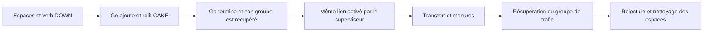

# Intégration CAKE Go puis trafic — contrat fonctionnel v1

Date : 1er novembre 2026.

## État et objectif

**Contrat défini ; [phase Go et gestion des groupes](LAB_CAKE_GO_PHASE.md) implémentées et testées avec ressources simulées. [Activation et continuité](LAB_CAKE_GO_TOPOLOGY.md) également implémentées en simulation ; [pilote à accusé](LAB_CAKE_GO_TRAFFIC.md) implémenté et testé avec outils simulés et vrais processus. [Collecte et contrôle global](LAB_CAKE_GO_COLLECT.md) implémentés et testés avec réseau simulé ; [préparation et relecture natives](LAB_CAKE_GO_ACTIVE_NATIVE.md) livrées ; [première validation native combinée](VALIDATION_CAKE_GO_ACTIVE_2026-11-01.md) confirmée.** Les [deux contrôles Go DOWN](VALIDATION_CAKE_GO_DOWN_2026-11-01.md) et le [contrôle CAKE actif Python](VALIDATION_LAB_CAKE_ACTIVE_2026-10-30.md) sont les preuves préalables. Leur réussite séparée ne valide pas leur enchaînement sur les mêmes ressources.

La première intégration doit vérifier un transfert sur le veth dont Go vient d’ajouter CAKE. Le processus Go termine son cycle DOWN avant activation. Le superviseur conserve les espaces et le lien, active la topologie, puis pilote le trafic et les mesures. Le backend Go garde ses exigences DOWN et son protocole actuel ; aucun contrôleur Go permanent n’est ajouté.

L’intervention relève d’une invocation locale explicite de ce contrôle de laboratoire. Elle n’exécute pas une recommandation `plan`, ne configure aucun réseau du foyer et ne qualifie aucun bénéfice Coopace.

## Responsabilités et organisation prévue

| Emplacement | Responsabilité |
| --- | --- |
| `apps/gateway/cmd/coopace-cake-worker` et `internal/labcontrol` | Cycle Go DOWN existant : initialisation, `ready`, `apply`, `applied`, `finish`, sortie. |
| `platforms/linux/cake_control*.go` | Ajout unique et relecture du profil fixe sur lien DOWN. |
| `scripts/lab_cake_go.py` | Transport, preuves Go et relecture indépendante ; `run_phase` conserve maintenant les espaces après récupération du groupe. |
| `scripts/lab_process_group.py` | Cycle de vie d’un groupe sans possession des namespaces ; utilisé par le superviseur. |
| `scripts/lab_cake_go_topology.py` | Activation et relectures de continuité après Go ; implémentées et testées en simulation. |
| `scripts/lab_cake_go_traffic.py` et `scripts/lab-cake-go-traffic.py` | Pilote privé à accusé, réutilisation du transfert et des sondes ; testé avec outils simulés et vrais processus. |
| `scripts/lab_cake_go_active.py` | Enchaînement, possession unique des ressources, groupes de processus, pilote de trafic et preuves combinées. |
| `scripts/lab_cake_go_collect.py` | Pipes bornés, vérification des trois PID, accusé/panne, relevés CAKE et récupération du groupe de trafic. |
| `scripts/lab-cake-go-active.py` | Entrée séparée : `plan`, `check`, `check-crash`, avec `--worker`, `--binaries` et `--artifacts`. |
| `scripts/lab_active.py`, `lab_cake.py`, `lab-series.py` | Activation, collecte, validation CAKE et mesure de charge à réutiliser. |
| `scripts/tests/test_lab_cake_go_active.py` | Tests d’enchaînement, de panne et de conservation des preuves. |

Le pilote privé, son raccordement, la collecte combinée et la CLI du contrôle actif sont implémentés et testés avec un réseau simulé. Leur [première validation native combinée](VALIDATION_CAKE_GO_ACTIVE_2026-11-01.md) est confirmée pour le transfert normal et la panne du pilote de trafic. Les commandes DOWN et les contrôles actifs historiques gardent leur format et leur comportement. Les opérations communes éventuellement extraites doivent être couvertes par leurs tests existants. `packages/core` et le protocole du groupe ne reçoivent ni processus ni opérations réseau.

## Ressources et séquence

Un seul superviseur possède les trois espaces `cg-JETON-c/g/s` et la réservation pendant toute l’expérience. Il ne recrée pas `wan` entre les phases.



1. Vérifier les outils, binaires et sources, créer les preuves exclusives et armer le délai global avant réservation des ressources.
2. Créer les trois espaces et le seul veth `wan`/`eth0`, sans adresse ni activation. Conserver les identités des espaces et du lien.
3. Exécuter le cycle Go normal complet : 14 appels, 36 enregistrements durables, code OS `0`, événements `ready`/`applied` et relectures conformes. Une erreur interdit toute activation.
4. Arrêter/récupérer le groupe Go, relire CAKE sur lien DOWN et fermer les références héritées. Conserver les espaces. Journaliser cette fin de phase avant de commencer la suivante.
5. Ajouter le veth `lan`/`eth0` du client, adresser et activer la topologie fixe ci-dessous. Revérifier les identités, les adresses/routes, le forwarding et CAKE, puis prendre le relevé avant trafic.
6. Démarrer le pilote de trafic dans un nouveau groupe. Effectuer le contrôle normal ou la panne définis ci-dessous, puis récupérer le groupe.
7. Relire la file après arrêt confirmé des outils, vérifier les preuves et empreintes, fermer les références restantes, puis retirer les seuls espaces possédés. Publier le succès uniquement après nettoyage confirmé.

`lab_cake_go.run` et `lab_active.run` suppriment actuellement leurs espaces dans `finally`. Leur appel successif ne réalise pas ce contrat. Cette extraction est maintenant [implémentée et testée en simulation](LAB_CAKE_GO_PHASE.md) : `run_phase` conserve les espaces et `advance_group` réserve le groupe suivant sans transfert de propriété des namespaces. Un résultat de phase ne peut pas publier le `cleanup_verified: true` d’un contrôle complet tant que les espaces sont conservés.

Les deux groupes ont des dossiers de suivi distincts : PID du leader, code OS et descendants récupérés. Le leader reste non récupéré jusqu’au dernier signal collectif ; aucun groupe n’est signalé après libération de son leader. Un groupe dont l’arrêt reste incertain interdit la phase suivante et la suppression des espaces concernés. Les PID annoncés par un enfant ne servent pas à signaler individuellement des processus étrangers.

## Topologie et continuité de la file

```text
client eth0         passerelle                         serveur eth0
10.203.0.2/30 -> lan 10.203.0.1/30
                   wan 10.203.0.5/30 [CAKE 10:] -> 10.203.0.6/30
```

La préparation reprend les deux routes spécifiques et le forwarding IPv4 du [contrôle actif existant](LAB_CAKE_ACTIVE.md), dans les seuls espaces neufs. Aucun NAT, route par défaut, interface physique ou accès Internet n’est ajouté. Le profil reste exactement `cake-ipv4-lab-4mbit-v1`, producteur `iproute2-6.1.0`.

Avant et après activation, confirmer la même identité de l’espace passerelle et de `wan` : indice, indice du pair, MTU et MAC. L’état, les adresses et la présence de `lan` évoluent uniquement selon l’activation prévue. Les interfaces attendues sont `lo`/`eth0` chez client et serveur, `lo`/`lan`/`wan` sur la passerelle ; les adresses et routes fixes sont relues. Tout ajout/remplacement/suppression de qdisc après la phase Go est interdit. Les options CAKE et chaque paire de compteurs successifs sont revérifiées jusqu’à la fin.

La continuité est établie dans ce laboratoire possédé par les identités, l’ordre des opérations et les relevés. La seule présence ultérieure d’une racine nommée CAKE ne suffit pas. Des références ou mutations détenues par un processus étranger restent hors garantie.

## Trafic, disponibilité et panne

Les paramètres reprennent le contrôle actif : transfert exact de 8 388 608 octets vers `10.203.0.6:46002`, plafond applicatif 1 048 576 octets/s, émetteur 25s et récepteur 28s. La cible `10.203.0.6:46001` accepte au plus 100 connexions pendant 30s. Dix sondes TCP utilisent timeout 1s, pause 250ms et condition déclarée `loaded`, au moins une seconde après première écriture.

Le [pilote interne](LAB_CAKE_GO_TRAFFIC.md) réutilise `measure_loaded` avec un callback de disponibilité propre à cette intégration. Après première écriture, il annonce le jeton et les trois PID des outils, puis attend un accusé du superviseur avant de poursuivre vers les sondes. Annonce et accusé sont stricts, liés à la session, limités chacun à 1 Kio et à 5s d’attente. Le superviseur vérifie les trois outils annoncés et leur groupe. Aucun quatrième outil de sondage ne démarre avant cet accusé.

L’annonce est une ligne `READY ` suivie d’un objet JSON v1 `lab_cake_go_active_ready` avec uniquement `schema_version`, `kind`, `session_id` et `helper_pids`, puis un saut de ligne. `helper_pids` contient trois entiers stricts positifs distincts, dans l’ordre cible/récepteur/émetteur. L’accusé sur stdin est une ligne JSON v1 `lab_cake_go_active_control` avec uniquement `schema_version`, `kind`, `session_id` et `action: continue`. Les limites de 1 Kio incluent préfixe éventuel et saut de ligne. Doublon, champ inconnu, mauvais type, jeton différent, EOF avant la ligne complète ou dépassement empêchent la poursuite. Après un accusé complet, EOF termine normalement le canal à message unique ; toute donnée supplémentaire empêche un succès. Ce dialogue appartient au pilote Python ; les trames du processus Go restent inchangées.

| Mode prévu | Décision après disponibilité | Conditions de fin |
| --- | --- | --- |
| `check` | Accuser réception, poursuivre le transfert et les sondes. | Pilote `0`, volume complet et EOF, rapports recalculés, compteurs monotones avec progression des octets, vidage, nettoyage. |
| `check-crash` | Tuer uniquement le pilote de trafic pendant l’attente de l’accusé. | Pilote `-9`, trois outils orphelins récupérés, relecture après arrêt, nettoyage ; `flow: null`. |

Le processus Go a déjà terminé avec `0` dans les deux modes. Le `check-crash` actif ne remplace pas le test DOWN de SIGKILL de Go et ne démontre pas sa mort pendant un appel d’outil. Cette panne Go reste à valider séparément.

En mode normal, conserver toutes les tentatives, leurs échecs éventuels et les indicateurs `has_successful_probe`/`probe_window_inside_application_writes`. Une collecte complète reste distincte d’un résultat natif positif : celui-ci exigera dix réussites et un recouvrement confirmé. Aucun seuil comparatif de débit ou de latence n’est appliqué. Le mode panne n’exige ni transfert complet ni vidage préalable ; ses relevés avant et après arrêt portent des étiquettes distinctes.

## Mesures, bornes et preuves

| Élément | Limite prévue |
| --- | --- |
| Superviseur unique | 180s monotones depuis avant création des ressources ; aucune remise à zéro entre phases. |
| Phase Go | Bornes DOWN existantes : 30s, frontières 5s, appels 2s, événements 128 Kio/512 Kio, journal 8 Mio. |
| Pilote de trafic | 45s ; annonce de disponibilité totale 15s ; chaque attente d’outil et accusé 5s ; sondes 16s. |
| Commandes du superviseur | 2s par appel `ip`/`tc`/`sysctl`. |
| Récupération d’un groupe avant transition | Au plus 10s, dans le délai global restant ; une incertitude interdit la transition. |
| Nettoyage final après succès ou erreur | Budget global de 10s ; arrêt des groupes avant retrait des espaces. |
| Collecte | 240 échantillons/1 Mio, sortie du pilote 256 Kio, journal du superviseur 4 Mio. |
| Cadence et vidage normal | Pause minimale 250ms après fin d’une lecture, sans rattrapage ; deux lectures vides espacées de 500ms sous 3s après fin du pilote. |

Les relevés sont datés et bornés ; la cadence réelle est conservée. Les différences concernent les cinq compteurs racine, jamais les jauges ou la somme racine/classe. Toute baisse constatée empêche un succès normal. Le point de départ de la différence de trafic est le relevé juste avant le pilote : du trafic IPv6 automatique peut contribuer aux compteurs après activation et ne devient pas un volume utile TCP ou une validation IPv6.

Le dossier neuf hors réservation conserve `environment.json`, les fichiers Go dans `go/` (`worker.jsonl`, `events.bin`, `worker.stderr`), le journal `supervisor.jsonl`, les sorties du pilote et `report.json`. Les noms et identités possédés, transitions, commandes d’activation, lectures brutes/normalisées, codes et récupérations y figurent. Les fichiers sont créés exclusivement sans écrasement ni suivi de symlink, privés et lisibles par le propriétaire du dossier d’expérience. Les transitions et preuves sont écrites puis synchronisées avant de poursuivre ; une erreur d’écriture interdit le succès et déclenche le nettoyage.

Le rapport prévu est un objet local v1 `lab_cake_go_active_check`, distinct du rapport DOWN. Il conserve `state`, `mode`, référence et jeton, provenance, phase Go, groupe de trafic, topologie, `queue_samples`, différences, `flow` et `cleanup_verified`. La phase Go porte son code et ses preuves avec nettoyage des espaces différé au superviseur ; elle ne fabrique pas un rapport DOWN terminé. Le rapport global garde `congestion: not_assessed` et `traffic_coverage: synthetic_ipv4_only`. `traffic_generated` décrit la charge synthétique annoncée : il vaut `false` tant que le pilote n’a pas été lancé, `null` si un incident après lancement laisse la première écriture inconnue, et `true` après son annonce validée.

Les outils et binaires — Python, `ip`, `tc`, `sysctl`, processus Go, agent et deux outils de trafic — sont identifiés par chemins canoniques, versions et SHA-256 avant réservation, revérifiés avant leurs lancements puis avant succès. Les versions textuelles des outils système sont conservées. Les programmes Go sans commande de version uniforme sont identifiés par leur SHA-256 ; leurs métadonnées d’exécution disponibles restent dans le journal Go et les exports de flux, avec absence de version préalable explicitée. Les sources de travail empreintées et le commit de contexte sont conservés. Le nettoyage n’est attesté que par le superviseur après récupération des deux groupes et disparition des ressources. Une erreur conserve `state: failed` et les preuves disponibles, même si le nettoyage a réussi. Les codes restent `0`, `1`, `2` et 129/130/143 selon les contrats existants.

## Faits observés et planification

La preuve de transfert et les compteurs sont recueillis après l’ajout. Ils ne peuvent pas satisfaire rétroactivement le prérequis de passage de `PlanStaticCake` avant cette intervention. Le nouveau contrôle ne transforme pas son invocation en un résultat de simulation exécutable et ne produit aucun `path_validated` utilisable comme autorisation préalable.

Le rapport conserve séparément : référence native validée, invocation locale de cette session, possession observée, supervision armée, permissions vérifiées, topologie/forwarding relus, réception TCP et compteurs observés. Leur portée et leur ordre restent visibles. Une collecte de laboratoire ne devient ni consentement persistant du foyer ni preuve de couverture IPv4/IPv6/DNS. Le contrôle négatif ICMP du forwarding et une campagne comparative restent des activités séparées.

## Ordre de réalisation et critères de validation

1. **Implémenté et testé en simulation** : [gestion d’une phase de processus et phase Go DOWN](LAB_CAKE_GO_PHASE.md) sans suppression des espaces. Tester récupération avant transition, fermeture répétée, absence de signal après récupération du leader et refus d’une seconde phase après arrêt incertain. Les commandes existantes gardent leurs tests et contrats.
2. **Activation et pilote implémentés séparément** : [topologie et continuité](LAB_CAKE_GO_TOPOLOGY.md) en simulation, [pilote à accusé](LAB_CAKE_GO_TRAFFIC.md) avec outils simulés et vrais processus. Le [raccordement et la collecte combinée](LAB_CAKE_GO_COLLECT.md) sont maintenant testés avec réseau simulé : échecs Go, code réel incompatible, identité/file modifiée, erreur d’activation, mauvais jeton/PID/groupe, EOF avant accusé, délais, baisse des compteurs, vidage absent et panne pendant attente.
3. **Testé avec réseau simulé et vrais processus** : deux groupes distincts et trois outils orphelins récupérés. Les erreurs de preuves et de nettoyage empêchent un succès ; les observations réseau restent simulées.
4. **Validé en natif** : commit et quatre binaires figés, dossier neuf par mode, deux contrôles et relecture indépendante. La [première validation native combinée](VALIDATION_CAKE_GO_ACTIVE_2026-11-01.md) conserve ses propres preuves, distinctes des rapports actifs Python.

La validation native normale exige mêmes ressources entre phases, unique ajout Go, réception complète, dix sondes réussies et recouvertes, progression cohérente, vidage et nettoyage. La panne exige Go `0`, pilote `-9`, trois descendants récupérés et nettoyage. Les journaux, codes, empreintes et absence des noms/réservations/PID sont relus hors ligne.

Le contrat et sa [première sous-étape d’extraction](LAB_CAKE_GO_PHASE.md) sont livrés. L’[activation et les validations de continuité](LAB_CAKE_GO_TOPOLOGY.md) sur les ressources conservées sont également implémentées et testées en simulation. Le [pilote de trafic à accusé](LAB_CAKE_GO_TRAFFIC.md) est maintenant implémenté et testé avec outils simulés et vrais processus. Le [raccordement, la collecte et le rapport global](LAB_CAKE_GO_COLLECT.md) sont maintenant implémentés et testés avec réseau simulé. Les [outils de préparation figée et de relecture](LAB_CAKE_GO_ACTIVE_NATIVE.md) sont livrés. La [première validation native combinée](VALIDATION_CAKE_GO_ACTIVE_2026-11-01.md) confirme les deux contrôles. Le [contrat de passage IPv4](LAB_CAKE_GO_PATH.md) et ses lecteurs purs sont livrés et testés sans réseau. Le [raccordement au superviseur](LAB_CAKE_GO_PATH_CONTROL.md) est maintenant implémenté et testé avec réseau simulé et vrais processus. Les [outils de préparation et de relecture natives du passage](LAB_CAKE_GO_PATH_NATIVE.md) sont livrés. La [validation native du passage IPv4](VALIDATION_CAKE_GO_PATH_2026-11-01.md) confirme les deux modes corrigés. Le [contrat de campagne répétée Go](LAB_CAKE_GO_CAMPAIGN.md) est défini avant collecte : trois paires repos/charge, dialogue lié à la session et critères séparés. Les [lecteurs et l’automate purs](LAB_CAKE_GO_CAMPAIGN_PROTOCOL.md) sont implémentés et couverts par quatorze tests. Le [pilote privé des six phases](LAB_CAKE_GO_CAMPAIGN_TRAFFIC.md) est livré et testé avec outils simulés et vrais processus. Le [collecteur des six phases](LAB_CAKE_GO_CAMPAIGN_COLLECT.md) est implémenté et testé avec réseau simulé : contrôle des PID, journal durable et vidage entre phases. L’[évaluation pure des mesures](LAB_CAKE_GO_CAMPAIGN_ASSESS.md) est implémentée et testée. Le [rapport global](LAB_CAKE_GO_CAMPAIGN_REPORT.md) la raccorde maintenant aux preuves du superviseur après nettoyage. La [commande de campagne](LAB_CAKE_GO_CAMPAIGN_CLI.md) est livrée. La [préparation des entrées](LAB_CAKE_GO_CAMPAIGN_PREPARE.md) est livrée séparément. La [relecture des phases](LAB_CAKE_GO_CAMPAIGN_PHASE_REVIEW.md) est livrée séparément. La [relecture globale du dossier figé](LAB_CAKE_GO_CAMPAIGN_GLOBAL_REVIEW.md) est maintenant livrée. Le [lanceur natif](LAB_CAKE_GO_CAMPAIGN_RUN.md) est livré ; les essais de cette campagne restent à réaliser. Le bénéfice propre à Coopace, l’automatisation, la restauration réelle, les autres plateformes et le ML restent ultérieurs.
