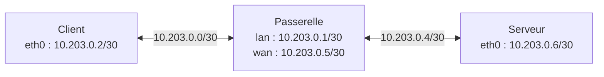

# Laboratoire Linux virtuel — préparation de l'étape 4.2

## Objectif et état

Le scénario utilise un hôte Linux et trois espaces réseau neufs : client, passerelle et serveur. Il prépare la vérification d'un point de passage logiciel sans raccorder les appareils du foyer. Linux est ici une plateforme de laboratoire, sans imposer ce système au produit final.

Le script et les tests simulés sont livrés. **La création réelle du laboratoire n'est pas encore validée.** Les capacités nécessaires sont absentes dans l'environnement isolé de développement ; aucun essai privilégié n'y est lancé. Aucun résultat de performance n'est revendiqué.



Le nom `wan` désigne ici le lien vers le serveur synthétique, pas un accès Internet. Les liens virtuels sont créés directement dans les nouveaux espaces. Le client et le serveur reçoivent uniquement des routes spécifiques vers l'autre sous-réseau. Aucun espace du laboratoire ne reçoit de route par défaut, de NAT, de lien physique ou de connexion au réseau de l'hôte. Le script ne modifie pas les interfaces, routes, pare-feu ou files de l'espace réseau de l'hôte.

Les espaces réseau ont leurs propres interfaces et routes ; des paires `veth` relient leurs extrémités. Voir les manuels [ip-netns](https://man7.org/linux/man-pages/man8/ip-netns.8.html) et [veth](https://man7.org/linux/man-pages/man4/veth.4.html). `ip netns` utilise aussi des noms et montages sous `/run/netns` ou `/var/run/netns` ; le répertoire parent peut rester présent après l'essai. Le noyau et les ressources physiques restent partagés.

## Prévisualiser

Depuis le dépôt, sans privilèges :

```sh
sh scripts/lab-network.sh plan
```

Sans argument, le script utilise aussi `plan`. Il affiche le scénario sans contrôle des privilèges, création de ressource ou sonde réseau.

## Exécuter sur la machine de laboratoire

Construire le binaire avec le compte habituel :

```sh
mkdir -p .local/bin .local/experiments
sh scripts/go.sh build -o .local/bin/coopace-gateway ./apps/gateway/cmd/coopace-gateway
```

`run` demande Linux, les outils `ip`, `ping` d'iputils, `sysctl`, `sed`, `mktemp`, `rmdir`, `id`, `uname`, puis l'UID effectif zéro et les capacités `CAP_NET_ADMIN`, `CAP_NET_RAW`, `CAP_SYS_ADMIN`. Les vérifications précèdent la création. Le script n'installe rien, ne compile rien et ne change pas lui-même ses privilèges. Un conteneur peut refuser l'essai même avec un UID zéro. Voir la [définition Linux des capacités](https://github.com/torvalds/linux/blob/master/include/uapi/linux/capability.h).

Après lecture du plan et du script, sur l'hôte de laboratoire :

```sh
sudo sh scripts/lab-network.sh run > .local/experiments/virtual-inventory.json 2> .local/experiments/virtual-lab.log
```

Le shell habituel ouvre les redirections avant `sudo` ; les fichiers restent créés avec ce compte. Choisir d'autres noms pour conserver plusieurs exécutions. Le script réserve seulement un répertoire temporaire privé pour son identifiant aléatoire, puis le supprime lors du nettoyage normal.

Contrairement à `coopace-gateway inspect`, qui reste en lecture seule, ce mode crée et configure un réseau temporaire de laboratoire. Aucun trafic du foyer n'y est dirigé.

## Déroulement et critères prévus

1. Créer les espaces `cp-IDENTIFIANT-c`, `cp-IDENTIFIANT-g`, `cp-IDENTIFIANT-s`. Les noms exacts et le répertoire réservé sont inscrits dans le journal ; les espaces préexistants ne sont pas réutilisés.
2. Créer les liens et adresses du schéma, puis les routes spécifiques dans le client et le serveur.
3. Désactiver le forwarding IPv4 **dans la passerelle neuve seulement**. Une sonde limitée à trois secondes doit retourner le code `1` d'iputils. Le code `2` signale une erreur technique ; il arrête l'essai, sans interprétation réseau. Un passage inattendu arrête aussi l'essai.
4. Activer le forwarding IPv4 dans cette passerelle. Trois réponses ICMP sont attendues dans un délai de cinq secondes ; tout retour non nul arrête l'essai.
5. Collecter `coopace-gateway inspect --json` dans la passerelle. L'inventaire peut rester partiel si d'autres lectures sont indisponibles.
6. Supprimer les seuls espaces dont la création a réussi et le répertoire temporaire. Publier le JSON sur stdout uniquement après un nettoyage réussi.

Les commandes locales de configuration n'ont pas de délai global dur ; aucune durée totale maximale n'est garantie. Le diagnostic conserve ses propres limites. Les réglages de forwarding et les codes de sonde sont décrits par le [noyau Linux](https://docs.kernel.org/networking/ip-sysctl.html) et le [manuel iputils ping](https://man7.org/linux/man-pages/man8/ping.8.html).

Le code `0` signifie que les vérifications prévues, l'inventaire non vide et le nettoyage ont abouti. Une erreur produit un code non nul ; `2` correspond notamment à des arguments invalides. Les interruptions gérées retournent `129`, `130` ou `143`. Un échec n'émet pas le JSON, même si sa collecte avait réussi avant un échec de nettoyage.

Le champ JSON `traffic_coverage` reste `unverified`. Le journal et le retour du script concernent uniquement le chemin IPv4 synthétique ; le diagnostic générique n'en déduit aucune couverture du foyer. L'absence de routes par défaut est intentionnelle dans ce laboratoire.

## Nettoyage et limites

Le nettoyage est tenté à la sortie normale, après une erreur et pour HUP/INT/TERM. Une collision de nom arrête la création sans supprimer l'espace en conflit. Il n'y a aucune suppression globale d'espaces réseau.

SIGKILL, un arrêt machine ou une erreur de suppression ne permettent pas de garantir le nettoyage. Reprendre les noms et le répertoire précis du journal, vérifier ces ressources, puis effectuer si nécessaire une suppression ciblée avec `ip netns del NOM_EXACT` et `rmdir CHEMIN_EXACT` pour le répertoire vide. Un espace dont le nom est supprimé peut subsister tant qu'un processus le référence, comme l'explique `ip-netns`.

Le nettoyage de ressources neuves n'est pas la restauration indépendante requise avant de piloter une passerelle réelle. Aucune file CAKE/SQM, règle de pare-feu ou politique de débit n'est appliquée. L'essai ne mesure pas le WAN, la radio, IPv6, DNS, l'équité ou la latence sous charge. Les statistiques ICMP ne sont pas des rapports `tcp_connect`.

## Validation et suite

Les tests utilisent de faux outils dans des répertoires temporaires et n'effectuent aucune opération réseau réelle. Ils couvrent prévisualisation, privilèges manquants, ciblage des espaces propres, nettoyage après erreur/interruption et absence de JSON après un échec de nettoyage.

```sh
sh -n scripts/lab-network.sh
python3 -B -m unittest discover -s scripts/tests -p 'test_*.py' -v
```

L'essai natif reste à exécuter et à consigner. Ensuite pourront être préparés des flux TCP synthétiques et une charge contrôlée dans ce chemin. La [référence initiale](GATEWAY_BASELINE.md), les mesures au repos/sous charge et la restauration réelle restent nécessaires pour poursuivre et clôturer l'étape 4.2.
