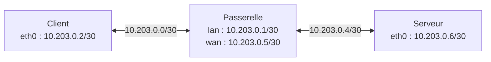

# Laboratoire Linux virtuel — préparation de l'étape 4.2

## Objectif et état

Le scénario utilise un hôte Linux et trois espaces réseau neufs : client, passerelle et serveur. Il prépare la vérification d'un point de passage logiciel sans raccorder les appareils du foyer. Linux est ici une plateforme de laboratoire, sans imposer ce système au produit final.

Le script, la cible TCP bornée et les tests simulés sont livrés. **Un premier essai natif ICMP/TCP est validé sur le PC Linux de l'utilisateur le 29 octobre 2026** : deux codes de sortie `0`, inventaire complet dans la passerelle virtuelle, cinq connexions TCP réussies sans échec et nettoyage normal. Le [compte rendu](VALIDATION_VIRTUAL_LAB_2026-10-29.md) conserve les preuves et limites. Les essais privilégiés sont lancés depuis le terminal utilisateur ; l'environnement isolé de développement conserve ses restrictions. Aucun gain de performance n'est revendiqué.



Le nom `wan` désigne ici le lien vers le serveur synthétique, pas un accès Internet. Les liens virtuels sont créés directement dans les nouveaux espaces. Le client et le serveur reçoivent uniquement des routes spécifiques vers l'autre sous-réseau. Aucun espace du laboratoire ne reçoit de route par défaut, de NAT, de lien physique ou de connexion au réseau de l'hôte. Le script ne modifie pas les interfaces, routes, pare-feu ou files de l'espace réseau de l'hôte.

Les espaces réseau ont leurs propres interfaces et routes ; des paires `veth` relient leurs extrémités. Voir les manuels [ip-netns](https://man7.org/linux/man-pages/man8/ip-netns.8.html) et [veth](https://man7.org/linux/man-pages/man4/veth.4.html). `ip netns` utilise aussi des noms et montages sous `/run/netns` ou `/var/run/netns` ; le répertoire parent peut rester présent après l'essai. Le noyau et les ressources physiques restent partagés.

## Prévisualiser

Depuis le dépôt, sans privilèges :

```sh
sh scripts/lab-network.sh plan
```

Sans argument, le script utilise aussi `plan`. Il affiche le scénario sans contrôle des privilèges, création de ressource ou sonde réseau.

## Exécuter sur la machine de laboratoire

Construire le binaire avec le compte habituel :

```sh
mkdir -p .local/bin .local/experiments
sh scripts/go.sh build -o .local/bin/coopace-gateway ./apps/gateway/cmd/coopace-gateway
```

Tous les modes d'exécution demandent Linux, les outils `ip`, `ping` d'iputils, `sysctl`, `sed`, `mktemp`, `rmdir`, `rm`, `sleep`, `cat`, `id`, `uname`, puis l'UID effectif zéro et les capacités `CAP_NET_ADMIN`, `CAP_NET_RAW`, `CAP_SYS_ADMIN`. Les binaires nécessaires dépendent du mode ; `run-series` demande aussi Python 3. Les vérifications précèdent la création. Le script n'installe rien, ne compile rien et ne change pas lui-même ses privilèges. Un conteneur peut refuser l'essai même avec un UID zéro. Voir la [définition Linux des capacités](https://github.com/torvalds/linux/blob/master/include/uapi/linux/capability.h).

Après lecture du plan et du script, sur l'hôte de laboratoire :

```sh
sudo sh scripts/lab-network.sh run > .local/experiments/virtual-inventory.json 2> .local/experiments/virtual-lab.log
```

Le shell habituel ouvre les redirections avant `sudo` ; les fichiers restent créés avec ce compte. Choisir d'autres noms pour conserver plusieurs exécutions. Le script réserve seulement un répertoire temporaire privé pour son identifiant aléatoire, puis le supprime lors du nettoyage normal.

Contrairement à `coopace-gateway inspect`, qui reste en lecture seule, ce mode crée et configure un réseau temporaire de laboratoire. Aucun trafic du foyer n'y est dirigé.

## Déroulement et critères prévus

1. Créer les espaces `cp-IDENTIFIANT-c`, `cp-IDENTIFIANT-g`, `cp-IDENTIFIANT-s`. Les noms exacts et le répertoire réservé sont inscrits dans le journal ; les espaces préexistants ne sont pas réutilisés.
2. Créer les liens et adresses du schéma, puis les routes spécifiques dans le client et le serveur.
3. Désactiver le forwarding IPv4 **dans la passerelle neuve seulement**. Une sonde limitée à trois secondes doit retourner le code `1` d'iputils. Le code `2` signale une erreur technique ; il arrête l'essai, sans interprétation réseau. Un passage inattendu arrête aussi l'essai.
4. Activer le forwarding IPv4 dans cette passerelle. Trois réponses ICMP sont attendues dans un délai de cinq secondes ; tout retour non nul arrête l'essai.
5. Collecter `coopace-gateway inspect --json` dans la passerelle. L'inventaire peut rester partiel si d'autres lectures sont indisponibles.
6. Supprimer les seuls espaces dont la création a réussi et le répertoire temporaire. Publier le JSON sur stdout uniquement après un nettoyage réussi.

Les commandes locales de configuration n'ont pas de délai global dur ; aucune durée totale maximale n'est garantie. Le diagnostic conserve ses propres limites. Les réglages de forwarding et les codes de sonde sont décrits par le [noyau Linux](https://docs.kernel.org/networking/ip-sysctl.html) et le [manuel iputils ping](https://man7.org/linux/man-pages/man8/ping.8.html).

Le code `0` signifie que les vérifications prévues, l'inventaire non vide et le nettoyage ont abouti. Une erreur produit un code non nul ; `2` correspond notamment à des arguments invalides. Les interruptions gérées retournent `129`, `130` ou `143`. Un échec n'émet pas le JSON, même si sa collecte avait réussi avant un échec de nettoyage.

Le champ JSON `traffic_coverage` reste `unverified`. Le journal et le retour du script concernent uniquement le chemin IPv4 synthétique ; le diagnostic générique n'en déduit aucune couverture du foyer. L'absence de routes par défaut est intentionnelle dans ce laboratoire.

## Mesurer des connexions TCP dans ce chemin

Le mode `run-tcp` crée une nouvelle instance du même réseau et effectue les contrôles ICMP précédents. Il remplace ensuite la collecte de l'inventaire par cinq tentatives `coopace latency` depuis le client vers `10.203.0.6:46001` : délai par tentative de `1s`, intervalle de `250ms`, condition déclarée `unspecified`. Aucune charge n'est ajoutée ; l'absence de charge générée ne prouve pas que la machine physique est au repos.

Construire avec le compte habituel les deux binaires nécessaires à ce mode :

```sh
mkdir -p .local/bin .local/experiments
sh scripts/go.sh build -o .local/bin/coopace ./apps/agent/cmd/coopace
sh scripts/go.sh build -o .local/bin/coopace-lab-tcp ./scripts/lab-tcp
```

Puis, sur la machine Linux de laboratoire :

```sh
sudo sh scripts/lab-network.sh run-tcp > .local/experiments/virtual-tcp.json 2> .local/experiments/virtual-tcp.log
```

La [cible TCP](../scripts/lab-tcp/README.md) écoute uniquement dans le serveur neuf. Elle ferme chaque connexion sans données applicatives et termine après cinq acceptations, avec expiration au bout de `15s`. Le script attend son annonce d'écoute pendant au plus 50 pauses de `0,1s`, puis lance les mesures. Il exige le retour réussi de l'agent et la fin normale du serveur après les cinq acceptations ; il arrête et attend son propre processus serveur avant toute suppression d'espace réseau en cas d'erreur ou d'interruption gérée. Le PID est inscrit dans le journal.

La sortie standard contient uniquement le [rapport local TCP v1](LATENCY.md), publié après nettoyage réussi. Ce mode n'exporte pas l'inventaire de la passerelle ; `run` reste disponible séparément. Les échecs individuels demeurent dans le rapport : le code `0` de l'agent signifie au moins une réussite, et les acceptations côté serveur ne remplacent pas les résultats côté client. Un échec du script laisse la sortie JSON vide ; le journal explique l'erreur.

Ces durées synthétiques concernent l'établissement TCP sur le noyau partagé de l'hôte. Elles ne mesurent pas une connexion Internet et ne constituent pas une référence au repos/sous charge. `declared_condition` étant `unspecified`, ce rapport n'est pas directement admissible à la comparaison `--idle`/`--loaded`.

## Nettoyage et limites

Le nettoyage est tenté à la sortie normale, après une erreur et pour HUP/INT/TERM. Une collision de nom arrête la création sans supprimer l'espace en conflit. Il n'y a aucune suppression globale d'espaces réseau.

Les interruptions gérées sont différées pendant la création d'un espace et l'enregistrement de son état, ainsi que pendant le lancement du serveur TCP et l'enregistrement de son PID. Cela permet au nettoyage de connaître la ressource qui vient d'être créée. Durant le nettoyage, les interruptions gérées supplémentaires sont ignorées ; le code initial est conservé. Le test de régression envoie SIGTERM juste après chaque création simulée. Voir la [revue du 29 octobre](REVIEW_2026-10-29.md).

SIGKILL, un arrêt machine ou une erreur de suppression ne permettent pas de garantir le nettoyage. Reprendre les noms, le PID éventuel et le répertoire précis du journal, vérifier ces ressources, puis effectuer si nécessaire une suppression ciblée avec `ip netns del NOM_EXACT`. Pour `run-tcp`, vérifier d'abord que le processus serveur de cette exécution est terminé ; retirer son fichier `tcp-ready` précis s'il subsiste, puis utiliser `rmdir CHEMIN_EXACT` pour le répertoire vide. Un espace dont le nom est supprimé peut subsister tant qu'un processus le référence, comme l'explique `ip-netns`.

Le nettoyage de ressources neuves n'est pas la restauration indépendante requise avant de piloter une passerelle réelle. Aucune file CAKE/SQM, règle de pare-feu ou politique de débit n'est appliquée à la passerelle. Les modes `run` et `run-tcp` ne mesurent pas la latence pendant un transfert ; `run-series` réalise cette mesure synthétique. Aucun de ces modes ne valide le WAN, la radio, IPv6, DNS ou l'équité. Les statistiques ICMP et le rapport `tcp_connect` restent des observations distinctes.

Le nouveau mode [`run-load`](VIRTUAL_LOAD.md) réutilise cette topologie et ces mécanismes pour préparer un flux synthétique de 8 Mio avec cadence applicative bornée. Son fichier de disponibilité s'appelle `load-ready` ; les mêmes règles de récupération ciblée s'appliquent à ce fichier précis si un arrêt brutal empêche sa suppression. Les [premières observations natives](VALIDATION_VIRTUAL_LOAD_2026-10-29.md) de ce mode confirment le transfert complet et le nettoyage normal ; il ne mesure pas encore simultanément la latence.

Le mode [`run-series`](VIRTUAL_SERIES.md) prépare cette mesure simultanée et trois paires de séries sur une seule création du laboratoire. Le pilote Python est suivi comme un processus propre par le shell et arrête ses outils avant de rendre la main. Un arrêt brutal peut laisser un sous-dossier privé `series-*` et le fichier `series-report` sous la réservation exacte du journal ; ils sont à inspecter avec les seuls noms de cette exécution. Un [premier essai natif des séries](VALIDATION_VIRTUAL_SERIES_2026-10-29.md) est désormais consigné, avec recouvrement et nettoyage conformes.

## Validation et suite

Les tests Python utilisent de faux outils dans des répertoires temporaires et n'effectuent aucune opération réseau réelle. Ils couvrent prévisualisation, privilèges ou binaire manquants, ciblage des espaces propres, échec du serveur ou de la mesure, arrêt du serveur avant suppression, nettoyage après erreur/interruption et absence de JSON après un échec de nettoyage. Les tests Go vérifient aussi l'endpoint avec des connexions en mémoire ; le test de boucle locale peut être ignoré faute de permissions.

```sh
sh -n scripts/lab-network.sh
python3 -B -m unittest discover -s scripts/tests -p 'test_*.py' -v
sh scripts/go.sh test -count=1 -v ./scripts/lab-tcp
```

Le premier essai natif ICMP/TCP et son nettoyage normal sont [consignés](VALIDATION_VIRTUAL_LAB_2026-10-29.md). Le transfert borné et les [séries répétées sans/avec trafic](VALIDATION_VIRTUAL_SERIES_2026-10-29.md) sont également validés dans ce chemin. Le [protocole de goulot virtuel](VIRTUAL_BOTTLENECK.md) définit les paramètres et le périmètre de nettoyage de l'expérience suivante ; sa mise en œuvre reste à réaliser. Les tests natifs d'interruption ou de panne de `lab-network.sh` ne sont pas encore effectués. Les [contrôles natifs du superviseur séparé](VALIDATION_LAB_GUARD_2026-10-29.md) sont validés, mais ce superviseur n'est pas encore intégré à ces modes. La [référence initiale](GATEWAY_BASELINE.md), les mesures avec goulot et la restauration réelle restent nécessaires pour poursuivre et clôturer l'étape 4.2.
